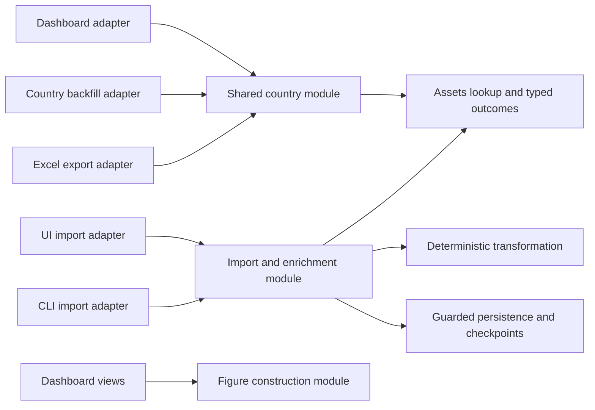

# Repository cleanup review

Reviewed on **19 October 2026**, against commit
`98c7aa5` and the current working tree.

The main cleanup opportunity is to concentrate rules that already differ between
the dashboard, exports, imports, and analysis notebooks. Several apparent DRY
problems have become correctness bugs. Fix those behaviors before moving files
or broadly extracting helpers.

This historical inventory records **40 findings**. Their current local implementation
and verification status, plus additional M01, are recorded in the
[cleanup verification report](repository-cleanup-verification-2026-10-20.md).
All original findings have local implementation evidence; deployed acceptance for
I02 and the staging checklist remain open. Six minor review follow-ups are listed
separately. The evidence and proposed fixes below describe the original review
snapshot; source line references are historical and may have moved.

## Scope and evidence

Reviewed all 23 root Python modules, the 19 `test_*.py` files, four tracked
notebooks, dependency declarations, Docker packaging, CI, shared tooling, and
repository documentation. The root Python modules contain 6,372 lines; the
notebooks contain another 1,767 lines of code source. The existing untracked
`.azure/` directory and ignored operational caches were excluded. No live Jira,
Assets, Azure model, production deployment, or browser security checks were run.

Concurrent deployment edits appeared during the review: asset relocation into
`assets/`, Docker startup changes, and tighter build-context exclusions. Those
changes were preserved. I02 records the observed local fix and I40 reflects the
remaining packaging scope. New deployment infrastructure was not audited here;
this review adds only this document.

This is an inventory of issues identified in this snapshot, not a guarantee that
every possible defect has been found. Runtime consequences below are either
demonstrated with synthetic inputs or explicitly described as configuration or
maintenance risks.

| Check                                                   | Current result                                                                                                                |
| ------------------------------------------------------- | ----------------------------------------------------------------------------------------------------------------------------- |
| Offline pytest suite                                    | **188 passed, 127 subtests passed**, 10 warnings, 10.75 seconds                                                               |
| Statement coverage                                      | **81%** overall; `jira_loader.py` 76%, `jira_country_export.py` 60%, `interactive.py` 57%, `build_board_deck.py` 0%           |
| Ruff 0.17.1, repository configuration                   | **359 diagnostics**: 121 in application/analysis Python, 212 in tests, 26 in notebooks                                        |
| Mypy 1.13.0, repository configuration                   | **418 errors in 42 files**, 44 source files checked: 409 missing annotations, 8 missing stubs, 1 incompatible assignment      |
| Public function/method signatures, root Python AST scan | 131 of 136 have incomplete annotations; 72 have no docstring                                                                  |
| Dependency manifests                                    | `requirements.txt` and `requirements.runtime.txt` are byte-for-byte identical; CI and Docker use different dependency sources |
| Synthetic behavior probes                               | 15 probe groups, detailed below; no external requests                                                                         |

The passing suite provides a useful baseline. It does not cover the reproduced
inputs listed below. Coverage percentages are statement coverage, not branch or
deployment coverage. Mypy was run through its isolated Trunk tool environment,
so the missing-stub diagnostics also reflect that environment.

Verification commands used:

```sh
.venv/bin/python -m pytest --cov-report=term \
  --cov-report=json:/private/tmp/evex-repo-review-coverage.json
.trunk/tools/ruff check --no-cache --output-format=json . \
  > /private/tmp/evex-repo-review-ruff.json
.trunk/tools/mypy --cache-dir=/private/tmp/evex-repo-review-mypy-cache \
  --no-incremental . > /private/tmp/evex-repo-review-mypy.txt 2>&1
```

The Ruff and mypy checks report failures. The Trunk launcher itself could not
write its global cache under the workspace sandbox; the already installed tool
entry points above worked. A complete `trunk check`, image build, vulnerability
database refresh, and clean dependency installation were not performed.

## Priority index

P1 means address promptly because repository data or deployment security is
affected. P2 means correctness, stale results, concurrency, or configuration drift
can affect normal work. P3 means maintainability, testability, or operational
cleanup; these can usually follow the targeted fixes.

| ID  | Priority | Finding                                                             |
| --- | -------- | ------------------------------------------------------------------- |
| I01 | P1       | Saved notebook ticket outputs — resolved in local source tree       |
| I02 | P1       | Docker cross-site protection override — resolved locally            |
| I03 | P2       | Missing timestamps crash imports or produce false fast resolutions  |
| I04 | P2       | Duration charts silently omit resolutions longer than 21 days       |
| I05 | P2       | Different tabs use different definitions of completed tickets       |
| I06 | P2       | Generic issue relationships are counted as clones                   |
| I07 | P2       | Deduplication compares timestamp strings instead of instants        |
| I08 | P2       | Country export excludes most of its selected end day                |
| I09 | P2       | Country reference selection differs between dashboard and export    |
| I10 | P2       | Country export caches lookup failures as missing country            |
| I11 | P2       | Country retry code discards Retry-After on error responses          |
| I12 | P2       | Source repair accepts an invalid search payload as an empty result  |
| I13 | P2       | Classifier cache ignores deployment, prompt, and schema changes     |
| I14 | P2       | Classifier cache can lose concurrent results                        |
| I15 | P2       | Classification schema accepts invalid category values               |
| I16 | P2       | Missing pandas scalars can abort a classification batch             |
| I17 | P2       | Successful country values have no refresh or expiry policy          |
| I18 | P2       | Password session revocation — resolved locally                      |
| I19 | P2       | Analysis notebook bypasses the normal-workspace category policy     |
| I20 | P2       | Analysis start date does not constrain the loaded cohort            |
| I21 | P2       | Dependency sources duplicate and diverge across CI and Docker       |
| I22 | P2       | Multiple environment readers conflict with the written standard     |
| I23 | P3       | Chart preparation and styling are copied across tabs                |
| I24 | P3       | Dashboard rendering, calculations, and maintenance share one script |
| I25 | P3       | Desk identity and transformation policy have separate registries    |
| I26 | P3       | Field IDs and reporting rules have several authorities              |
| I27 | P3       | Persistence primitives are repeated and cause an import cycle       |
| I28 | P3       | Transformation performs hidden live link enrichment                 |
| I29 | P3       | Cached dataframe schema and migrations are implicit                 |
| I30 | P3       | Failure reporting loses actionable context or hides errors          |
| I31 | P3       | Unused functions and inactive implementations remain                |
| I32 | P3       | Supported analysis and historical experiments are not separated     |
| I33 | P3       | Default dependencies include unused and analysis-only packages      |
| I34 | P3       | Typing contracts are mostly absent and excluded from CI             |
| I35 | P3       | Lint configuration and current code disagree                        |
| I36 | P3       | CI does not exercise the production installation and image          |
| I37 | P3       | Data paths depend on the process working directory                  |
| I38 | P3       | Backups and checkpoints have no retention policy                    |
| I39 | P3       | Documentation contains dead links and conflicting setup paths       |
| I40 | P3       | Docker copies development and analysis artifacts into the image     |

## Security and repository data

### I01 P1 Ticket-level text is saved in a tracked notebook

**Closure, 20 October 2026:** All four tracked notebooks have empty code-cell
outputs and null execution counts. A read-only CI guard and 15 synthetic tests
protect the policy. Source, IDs and unrelated metadata match the captured
foundation. Earlier Git versions are retained; the notebook commit remains
blocked by the existing Trunk notebook adapter failure.

**Evidence:** [amparex_ai_assist_analysis.ipynb:600](../amparex_ai_assist_analysis.ipynb#L600)
and [cell 19 at line 2438](../amparex_ai_assist_analysis.ipynb#L2438).
Zero-based cell 12 saves 30 ticket-level rows with keys, summaries, classification
fields, and reasoning; cell 19 saves 12 additional rows. The notebook contains
38 saved outputs totaling approximately 139 KB of serialized output. No ticket
text is reproduced here.

Git retains these records even though [.dockerignore:18](../.dockerignore#L18)
excludes notebooks from images. Strip ticket-bearing outputs and add an output
check before commit/CI. Preserve permitted aggregate results separately. Removing
current outputs does not erase earlier Git versions; assess any history cleanup
as a separate change. **Validate:** notebook output inspection shows no row-level
ticket text, and the guard rejects a synthetic ticket table.

### I02 P1 Docker cross-site protection override resolved locally

**Status: resolved in concurrent local edits; deployment not verified.** The
audit baseline (`git show 98c7aa5:Dockerfile`, line 28) explicitly passed
`--server.enableCORS=false` and `--server.enableXsrfProtection=false`, disabling
framework protections independently of the password gate.

**Phase 0 verification, 20 October 2026:** Static regression tests inspect CLI,
Docker ENV and TOML declarations and reject unsupported shell expansions. The
port expansion is quoted as one argument, preventing it from adding flags.
Live image/proxy/platform overrides still need deployment evidence.

The current [Dockerfile:34](../Dockerfile#L34) removes both overrides. Preserve
that fix and verify it through the deployment proxy. Exploitability and deployed
behavior were not tested. **Validate:** the deployed command retains the defaults
and login, widgets, uploads if used, and refresh work through the real proxy.

### I18 P2 Password rotation does not invalidate authenticated sessions

**Closure, 20 October 2026:** Password generations now revoke legacy/stale
sessions before ticket reads. Both timed import fragments revalidate before
status reads or start/resume actions and return stale sessions to the full login
gate. Rotation, logout, public-mode transitions, Unicode, and callback/render
races pass offline tests. Already delivered browser data cannot be withdrawn;
changes away and back between all gate observations are not detected.

**Evidence:** [ui_auth.py:28](../ui_auth.py#L28) reads the current password, but
[ui_auth.py:32](../ui_auth.py#L32) trusts an existing `_ui_authed` boolean without
binding it to that password or an authentication generation.

Probe R12 changes the configured secret while keeping an authenticated session;
the gate neither requests login nor stops rendering. A password change therefore
does not revoke existing sessions. Define the desired revocation behavior and
bind session authentication to a server-side generation or secret-derived
fingerprint without storing the plaintext secret. **Validate:** rotation and
logout revoke the expected sessions; fresh login and Unicode passwords still work.

## Analytics and import correctness

### I03 P2 Missing timestamps crash imports or produce false fast resolutions

**Evidence:** [data_transformation.py:70](../data_transformation.py#L70) coerces
bad dates to `NaT`, but [line 189](../data_transformation.py#L189) passes them to
`np.busday_count`. The nested business-time helper at
[line 127](../data_transformation.py#L127) returns zero for a missing endpoint.

Probe R4 shows that a missing `created` or `updated` raises `ValueError`, causing
the containing desk transformation to fail. A done ticket with a missing
resolution timestamp instead receives **0 business hours** and the
**≤ 1 Stunde** band. Validate required dates and distinguish unknown/invalid
duration from zero duration. **Validate:** malformed, missing, and reversed
timestamps have an explicit outcome without dropping an entire valid desk or
improving its resolution KPI.

### I04 P2 Duration charts silently omit resolutions longer than 21 days

**Evidence:** [data_transformation.py:67](../data_transformation.py#L67) ends
duration bins at `21 * 24` hours; [line 177](../data_transformation.py#L177)
uses `pd.cut`. [plotting.py:38](../plotting.py#L38) groups those bins without
retaining an out-of-range category.

Probe R5 supplies one done ticket resolved after 940 hours. It contributes
**zero tickets** to the duration chart. Add an overflow band and explicit
handling of unknown/invalid durations. **Validate:** each duration chart accounts
for the entire declared completed-ticket cohort, including the final edge,
longer durations, and unknown dates.

### I05 P2 Different tabs use different definitions of completed tickets

**Evidence:** [data_transformation.py:82](../data_transformation.py#L82) derives
`is_done` from `currentstatus_name`; [plotting.py:26](../plotting.py#L26) repeats
that check. [app.py:574](../app.py#L574) and
[app.py:631](../app.py#L631) compare `status_category` to the localized string
`Fertig` instead.

Probe R15 uses the existing synthetic fixture: metrics consider the ticket done,
the open-status tab includes it as open, and the customer tab excludes it.
Concentrate completion semantics in one normalized field and deliberately define
how inconsistent Jira status sources are handled. **Validate:** all views agree
for localized categories, custom statuses, and inconsistent source fields.

### I06 P2 Generic issue relationships are counted as clones

**Evidence:** [data_transformation.py:279](../data_transformation.py#L279)
counts every outward relationship in `n_clones`, without checking its type.
[line 420](../data_transformation.py#L420) reads an inward relationship only
from the first link. [app.py:646](../app.py#L646) labels the results Clone Tickets.

Probe R10 supplies a `Blocks` relationship and receives one clone. Multiple
inward relationships are also not represented by the single `cloned_by` value.
Define separate generic-link and clone concepts; preserve the documented generic
link behavior while making clone counts/type/direction explicit. **Validate:**
mixed link types, inward/outward links, and multiple related issues are represented
without inflating clone metrics or losing generic relationships.

### I07 P2 Deduplication compares timestamp strings instead of instants

**Evidence:** [jira_loader.py:250](../jira_loader.py#L250) returns the raw
`fields.updated` string; [line 269](../jira_loader.py#L269) compares it directly.

Probe R3 gives the same ticket timestamps `12:00+0200` and `11:00+0000`.
The implementation keeps the first, although it is an hour older. Equivalent
representations and differing fractional precision are additional edge cases.
Parse and compare UTC instants, retaining the documented later-input tie rule.
**Validate:** mixed offsets, equal instants, missing dates, and duplicate records
produce a deterministic and correctly ordered result.

## Country and source enrichment

### I08 P2 Country export excludes most of its selected end day

**Evidence:** [jira_country_export.py:157](../jira_country_export.py#L157)
parses both `--start` and `--end` at midnight. The maintained import path uses
[service_desks.py:50](../service_desks.py#L50) for an inclusive end day.

Probe R1 shows that an export ending on 2 September ends at
`2026-09-02T00:00:00+02:00`, excluding almost the entire selected day. The export
also has a fixed end default of `2026-12-31` at
[line 246](../jira_country_export.py#L246), which will age. Use the shared date
policy and an intentional dynamic default. **Validate:** exports and imports
select the same tickets at midnight, end of day, and DST transitions.

### I09 P2 Country reference selection differs between dashboard and export

**Evidence:** [data_transformation.py:343](../data_transformation.py#L343)
selects the first reference and [line 368](../data_transformation.py#L368)
accepts a missing workspace marker for legacy input.
[jira_country_export.py:132](../jira_country_export.py#L132) selects the last
reference and rejects a missing workspace marker.

Probe R6 confirms first-versus-last disagreement on the same synthetic field.
Concentrate reference parsing, workspace checks, escalation order, and legacy
handling in a shared country module used by both adapters. Preserve rejection
of foreign workspaces. **Validate:** dashboard and export agree on multi-reference,
legacy, empty, malformed, and foreign-workspace inputs.

### I10 P2 Country export caches lookup failures as missing country

**Evidence:** [jira_country_export.py:88](../jira_country_export.py#L88)
caches a resolver that catches every exception and returns `None`. The export
uses it at [line 146](../jira_country_export.py#L146), reports only
with/without country at [line 262](../jira_country_export.py#L262), and completes
without a failure exit status. The strict resolver exists separately at line 108.

Probe R14 fails the first lookup, then calls the same object again. The fetch
runs only once: the failure is cached. A temporary outage is indistinguishable
from an asset that truly has no country. Reuse typed lookup outcomes and the
strict resolution policy; report incomplete exports and automation exit status.
**Validate:** a transient failure can recover, an absent attribute stays distinct,
and permanent lookup failures remain visible in export results.

### I11 P2 Country retry code discards Retry-After on error responses

**Evidence:** [jira_country_export.py:78](../jira_country_export.py#L78)
checks `if exc.response`. A Requests response with HTTP 429 or 5xx is false in
boolean context, so this branch discards its header.

Probe R2 supplies HTTP 429 with `Retry-After: 120`; the code sleeps **2 seconds**.
The category resolver already handles explicit response presence and HTTP-date
headers at [category_sync.py:38](../category_sync.py#L38). Concentrate retry
parsing and explicitly choose retryable exceptions, limits, and delay caps.
**Validate:** numeric/date headers, missing or malformed headers, connection
failures, and permanent 403/404 outcomes follow the intended policy.

### I12 P2 Source repair accepts an invalid search payload as an empty result

**Evidence:** [source_sync.py:42](../source_sync.py#L42) reads
`page.get("issues", [])` without checking `errorMessages` or a required issue
array. [jira_loader.py:327](../jira_loader.py#L327) performs both checks for the
main importer.

Probe R13 returns an HTTP-success payload containing only `errorMessages` and
gets `{}` rather than an error. Source repair can report zero updates without
surfacing the failed search. Share successful-response validation while preserving
the intentional treatment of genuinely inaccessible/omitted issues. **Validate:**
valid empty searches succeed; malformed/error payloads fail visibly and are not
reported as successful repairs.

### I17 P2 Successful country values have no refresh or expiry policy

**Evidence:** [asset_country.py:109](../asset_country.py#L109) fetches only
IDs absent from the disk mapping. [line 207](../asset_country.py#L207) retries
only null entries. [jira_loader.py:47](../jira_loader.py#L47) additionally caches
successful full Assets responses without an expiry or size bound.

Changing an asset's country in Jira does not make a successful cached value
eligible for a later country update. Repeated button clicks therefore cannot
reconcile such changes. Add a deliberate refresh/invalidation policy with
workspace-aware cache metadata, and bound the in-process cache. **Validate:** a
changed country becomes observable without hand-editing files, while ordinary
reruns retain useful caching and failed lookups remain retryable.

## Classifier correctness and persistence

### I13 P2 Classifier cache ignores deployment, prompt, and schema changes

**Evidence:** [ticket_classifier.py:391](../ticket_classifier.py#L391)
marks rows reusable using only ticket key and text hash. Deployment is saved at
[line 320](../ticket_classifier.py#L320), but is not part of cache validity.
Prompt, taxonomy, and schema versions are not recorded in the validity key.

Probe R8 switches from an old deployment to a new one and makes zero model calls,
returning the old result. Include an explicit classification version covering
prompt/schema/taxonomy and the selected deployment configuration. Preserve
`force` as an explicit override. **Validate:** identical versions/text reuse work;
changed deployment or classification policy invalidates the relevant rows.

### I14 P2 Classifier cache can lose concurrent results

**Evidence:** [ticket_classifier.py:276](../ticket_classifier.py#L276)
uses the shared filename `<cache>.tmp` without a storage lock.
[line 385](../ticket_classifier.py#L385) captures a baseline once, and
[line 423](../ticket_classifier.py#L423) merges subsequent flushes against that
baseline rather than the current disk state. The lock at line 413 is local to
one invocation and does not protect another invocation or process.

Probe R11 simulates two captured baselines: after writing tickets 2 and 3, ticket
2 is lost. Real simultaneous writes can also collide on the temporary file.
Use unique temporary files and a shared read/merge/write transaction, with a
defined conflict rule. **Validate:** independent writers retain both result sets,
newer classifications are protected, and interrupted writes leave a valid cache.

### I15 P2 Classification schema accepts invalid category values

**Evidence:** [ticket_classifier.py:110](../ticket_classifier.py#L110),
[line 113](../ticket_classifier.py#L113), and
[line 120](../ticket_classifier.py#L120) declare unrestricted strings. Allowed
values and bucket/sub-bucket relationships exist only in descriptions/prompts.

Probe R7 constructs a valid `TicketClassification` with `invalid` for all three
categorical fields. Structured output therefore does not enforce the domain
taxonomy. Use constrained values and cross-field validation, with an explicit
failure outcome. **Validate:** unknown values and mismatched bucket/sub-bucket
pairs are rejected; valid taxonomy combinations survive serialization and caching.

### I16 P2 Missing pandas scalars can abort a classification batch

**Evidence:** [ticket_classifier.py:226](../ticket_classifier.py#L226)
and subsequent fields use `row.get(...) or ""`. A `pd.NA` scalar cannot be
evaluated as a boolean. [line 386](../ticket_classifier.py#L386) constructs
every prompt before entering per-ticket error isolation.

Probe R9 raises `TypeError: boolean value of NA is ambiguous` for a missing
summary. One nullable dataframe value can stop all classification work. Normalize
missing scalars explicitly and validate key/text inputs per ticket. **Validate:**
`None`, `pd.NA`, `NaN`, blank text, and malformed rows have explicit outcomes
without aborting unrelated valid tickets.

## Analysis consistency

### I19 P2 Analysis notebook bypasses the normal-workspace category policy

**Evidence:** [amparex_ai_assist_analysis.ipynb:230](../amparex_ai_assist_analysis.ipynb#L230)
loads the current cache; [line 290](../amparex_ai_assist_analysis.ipynb#L290)
then fills unresolved labels from the static objectId-only category map. Runtime
[data_transformation.py:385](../data_transformation.py#L385) intentionally refuses
that fallback for enriched normal-workspace inputs.

Notebook and deck category analysis can consequently disagree with the dashboard
and hide unresolved Assets provenance. This changes the notebook frame, not the
stored dashboard cache. Use the authoritative category policy, or explicitly
freeze and label the notebook as a historical reconstruction. **Validate:** modern
unresolved/foreign references cannot acquire an unrelated legacy label; genuinely
legacy inputs retain their documented compatibility behavior.

### I20 P2 Analysis start date does not constrain the loaded cohort

**Evidence:** [amparex_ai_assist_analysis.ipynb:104](../amparex_ai_assist_analysis.ipynb#L104)
declares `START_DATE`. It is used for an optional pull, but the actual dataframe
selection at [line 238](../amparex_ai_assist_analysis.ipynb#L238) filters only by
project key. Imports deliberately preserve older cached history.

An expanded existing cache silently broadens the analysis despite identical
notebook settings. Apply the requested date window after loading and persist the
cohort period, extraction time, and input digest with analysis results.
**Validate:** extra cached rows outside the configured window do not change the
analysis, and reruns identify the exact input cohort.

## Configuration and dependencies

### I21 P2 Dependency sources duplicate and diverge across CI and Docker

**Evidence:** `requirements.txt:1` (removed after the review) and
[requirements.runtime.txt:1](../requirements.runtime.txt#L1) are identical.
Docker installs the latter at [Dockerfile:9](../Dockerfile#L9); CI installs
`pyproject.toml`/`uv.lock` at [.github/workflows/ci.yml:27](../.github/workflows/ci.yml#L27).
The former pin selected runtime packages; the latter contains broader ranges and
a different default graph. Runtime transitive dependencies are not fully locked.

Package compatibility verified in CI does not establish the Docker dependency
set. Keep one authored dependency source and generate/check any production
export, with a complete reproducible graph. **Validate:** a clean production
installation matches its tested lock/export, and a dependency update cannot
leave an independently maintained requirements file stale.

### I22 P2 Multiple environment readers conflict with the written standard

**Evidence:** [jira_loader.py:14](../jira_loader.py#L14) and
[data_transformation.py:16](../data_transformation.py#L16) load `.env` with override
and snapshot credentials at import. [source_sync.py:19](../source_sync.py#L19)
reloads a specific file at call time; [ui_auth.py:17](../ui_auth.py#L17) parses
it separately. [.claude/standards/python.md:85](../.claude/standards/python.md#L85)
forbids application `.env` reads, while [README.md:34](../README.md#L34)
promises the existing override behavior.

Different paths can observe different credentials after configuration changes,
and a local file can override injected deployment values. Settle the contract,
then concentrate validated configuration and client construction in one module.
If adopting the written standard, inject local files through the launcher.
**Validate:** fresh process, cached-only UI, override precedence, missing values,
and configuration changes behave consistently without logging secrets.

### I25 P3 Desk identity and transformation policy have separate registries

**Evidence:** [service_desks.py:23](../service_desks.py#L23) owns desk identity
and company names; [data_transformation.py:508](../data_transformation.py#L508)
repeats company strings, desk keys, loader selection, and clone targets.

Adding a desk requires coordinated edits in multiple places, allowing supported
UI desks and supported transformations to differ. Concentrate desk identity and
transformation policy in the desk-policy module. Preserve existing public
loaders as compatibility adapters if needed. **Validate:** every configured desk
has exactly one policy, including its intentional comment separator and escalation
targets, and UI/CLI choices come from the same authority.

### I26 P3 Field IDs and reporting rules have several authorities

**Evidence:** custom-field IDs recur in
[jira_loader.py:141](../jira_loader.py#L141),
[category_sync.py:11](../category_sync.py#L11),
[data_transformation.py:418](../data_transformation.py#L418),
[source_sync.py:55](../source_sync.py#L55), and
[jira_country_export.py:46](../jira_country_export.py#L46). Berlin time, business
hours, completion strings, and day length recur in
[service_desks.py:7](../service_desks.py#L7),
[data_transformation.py:37](../data_transformation.py#L37), and
[resolution_bands.py:33](../resolution_bands.py#L33). Cloud/workspace IDs are fixed
at [jira_loader.py:21](../jira_loader.py#L21).

These are legitimate business/deployment values; duplication and validation are
the problem. Give field mappings and reporting policy one authority, with tenant
identity supplied or validated deliberately. Derive a working-day length from its
hours when appropriate. **Validate:** changing a field mapping or reporting window
updates fetch retention, transformation, repair, export, and bands consistently.

### I33 P3 Default dependencies include unused and analysis-only packages

**Evidence:** [pyproject.toml:9](../pyproject.toml#L9) declares `anthropic`,
which has no imports in the tracked modules/notebooks. Both `dotenv` and
`python-dotenv` are declared; the former is a shim depending on the latter.
Jupyter is in default dependencies at [line 13](../pyproject.toml#L13), while
OpenAI and tqdm support the classifier rather than the dashboard. Direct imports
of `requests` and `pydantic` currently rely on transitive dependencies.

Separate dashboard/export, notebook/classification, and development dependency
groups; remove the unused Anthropic package and redundant shim after checking
supported workflows. Declare directly imported packages in the appropriate group.
Keep `openpyxl`: `to_excel` needs an Excel writer even without an explicit import.
**Validate:** each supported workflow runs in its intended clean dependency group.

## Architecture and DRY

### I23 P3 Chart preparation and styling are copied across tabs

**Evidence:** [app.py:193](../app.py#L193),
[app.py:257](../app.py#L257), and [app.py:395](../app.py#L395)
repeat grouping, percentages, view-mode selection, labels, totals, and layout.
[plotting.py:89](../plotting.py#L89) already implements the same sequence.
Callers even repeat knowledge of bar/scatter styling order.

Deepen the chart module so those rules have locality behind a small interface.
Separate deterministic figure construction from Streamlit controls; avoid simply
adding switches to the existing 14-parameter helper. **Validate:** shared figure
checks cover totals, missing groups, ordering, relative mode, log mode, and bar
styling, while each tab keeps its distinct reporting semantics and widget state.

### I24 P3 Dashboard rendering, calculations, and maintenance share one script

**Evidence:** the 815-line [app.py](../app.py#L1) executes all 13 tab sections
at module scope. It contains aggregations, presentation policy, cache fallback,
and source/country maintenance transactions at [line 740](../app.py#L740).
Empty-state import rendering is repeated at lines 121, 129, and 142.

This widens the interface maintainers must understand for a small view change and
repeats substantial work on ordinary reruns. Extract cohesive view/maintenance
modules and share empty-state rendering while preserving current controls.
Scope custom styling too: [styles.py:11](../styles.py#L11) targets every
`p/div/span/label`, and line 29 relies on a generated framework class.
**Validate:** independent widgets, empty states, cache reloads, password gating,
and background imports retain their behavior; measure rerun cost before optimizing.

### I27 P3 Persistence primitives are repeated and cause an import cycle

**Evidence:** temporary-write/replace logic appears in
[data_loading.py:128](../data_loading.py#L128),
[asset_country.py:85](../asset_country.py#L85),
[desk_sync.py:28](../desk_sync.py#L28),
[backfill_country.py:93](../backfill_country.py#L93), and
[ticket_classifier.py:276](../ticket_classifier.py#L276), with differing locking
and temporary-file behavior. [sync_checkpoints.py:9](../sync_checkpoints.py#L9)
imports its JSON helper from `desk_sync`, which imports checkpoints inside
[run_sync at line 282](../desk_sync.py#L282).

Give low-level atomic file primitives a neutral home and retain format-specific
transaction policy in the owning module. The checkpoint module has real depth;
do not delete its recovery behavior merely to reduce file count. **Validate:**
interrupted writes, concurrent writers, cleanup of temporary files, nested cache
transactions, and imports from a fresh process work consistently.

### I28 P3 Transformation performs hidden live link enrichment

**Evidence:** [data_transformation.py:401](../data_transformation.py#L401)
calls link traversal during dataframe extraction; every outward link can invoke
`get_jira().issue(key)` at [line 260](../data_transformation.py#L260). The client
is cached, but linked-issue responses are not deduplicated across source tickets.

Offline transformation can silently produce reduced link metrics, and repeated
targets cause repeated synchronous network reads. Deepen the import/enrichment
module behind an explicit seam; supply already enriched link data to deterministic
transformation. **Validate:** shared targets fetch once per intended refresh,
offline conversion makes no requests, and incomplete link enrichment is reported
through the import interface. No performance benchmark was run for this finding.

### I29 P3 Cached dataframe schema and migrations are implicit

**Evidence:** [data_loading.py:143](../data_loading.py#L143) deserializes a
bare dataframe without a schema version. [app.py:66](../app.py#L66) repairs one
column ad hoc, [app.py:516](../app.py#L516) checks two others, while most charts
index required columns directly. `_ISSUE_COLUMNS` at
[data_transformation.py:300](../data_transformation.py#L300) covers extraction,
not the complete enriched cache contract.

Old or malformed caches are handled differently depending on which view reads
them. Define one cache schema/version and explicit migrations/validation, including
nullability and date/boolean/category types. **Validate:** representative legacy
caches either migrate deterministically or produce an actionable error before
rendering. Pickle is currently a trusted local format; no untrusted-input exploit
is claimed here.

### I30 P3 Failure reporting loses actionable context or hides errors

**Evidence:** [app.py:69](../app.py#L69) turns any cache-load exception into
an empty dashboard. [asset_country.py:127](../asset_country.py#L127) reduces
all lookup exceptions to a count. [data_transformation.py:268](../data_transformation.py#L268)
prints link failures and continues. Other paths persist only exception class names,
for example [desk_sync.py:379](../desk_sync.py#L379).

A corrupt cache, permission error, malformed asset, and ordinary missing data
can be difficult to distinguish. Concentrate safe structured diagnostics and
explicit failure outcomes at the appropriate seam. Preserve desk/optional-step
isolation; removing every broad catch would regress that behavior.
**Validate:** users receive a useful outcome and operators receive a safe cause
and operation identifier, without storing credentials or ticket text in diagnostics.

## Code, tooling, and delivery hygiene

### I31 P3 Unused functions and inactive implementations remain

**Evidence:** [plotting.py:267](../plotting.py#L267) defines unused
`apply_filters`, which assumes an `assignee` column absent from the maintained
extraction. [jira_loader.py:364](../jira_loader.py#L364) defines unused
`parse_clone_links`; `get_workspace_id` and `get_workspaces` at lines 64 and 74
also have no tracked callers. [data_transformation.py:225](../data_transformation.py#L225)
contains an inactive 25-line earlier implementation; `BUS_START`/`BUS_END` are
otherwise only referenced by that string.

Delete verified unused code after checking external consumers, and use Git for
old implementations. Remove unreachable scaffolding such as the `NameError`
fallback around a same-module function at [plotting.py:201](../plotting.py#L201).
**Validate:** tracked callers/imports and supported entry points still work.
Functions called by notebooks, including schema enumeration and classification,
must not be removed as allegedly dead code.

### I32 P3 Supported analysis and historical experiments are not separated

**Evidence:** four notebooks contain 1,767 code-source lines alongside the live
application. [jira_analysis.ipynb:145](../analysis/archive/jira_analysis.ipynb#L145) calls the
loader with obsolete arguments, including a duplicate `max_issues` value;
[line 195](../analysis/archive/jira_analysis.ipynb#L195) also passes an old client/JQL interface.
[build_board_deck.py:11](../build_board_deck.py#L11) intentionally embeds a
historical numerical snapshot and contributes 1,116 root Python lines.

Label/archive unsupported experiments and identify the maintained analysis path.
Keep the reproducible historical deck, but attach its cohort and classification
provenance; do not replace its literals with live data by default. Scope analysis
coverage separately rather than treating the entire deck as runtime code.
**Validate:** the supported notebook can execute against maintained interfaces;
historical artifacts are clearly marked and retain their reproducibility.

### I34 P3 Typing contracts are mostly absent and excluded from CI

**Evidence:** [.claude/standards/python.md:22](../.claude/standards/python.md#L22)
requires public annotations; [pyproject.toml:74](../pyproject.toml#L74) enables
`disallow_untyped_defs`; [.github/workflows/ci.yml:52](../.github/workflows/ci.yml#L52)
explicitly filters mypy out. The current check reports 409 missing-annotation
errors, plus stub/configuration and one assignment error.

The strict configuration is not an enforced contract. Prioritize import requests,
reports, persistence, lookup outcomes, and dataframe expectations, then enforce a
deliberate incremental scope. Resolve stub/tool environments alongside annotations.
**Validate:** the chosen typed module interfaces pass a documented CI check and
new untyped code cannot silently expand that scope's debt.

### I35 P3 Lint configuration and current code disagree

**Evidence:** [pyproject.toml:57](../pyproject.toml#L57) enables naming,
docstring, and style rules. The current Ruff run reports 359 diagnostics, including
277 missing public function/class/method docstrings and 28 overlong lines.
The configured tools at [.trunk/trunk.yaml:34](../.trunk/trunk.yaml#L34) include
Black, isort, and Ruff, overlapping with the standards' description of Ruff-owned
formatting/import order.

Choose the authoritative formatter/import tool and an explicit policy for tests,
notebooks, and production interfaces. Fix diagnostics or record a targeted baseline;
do not disable useful rules globally to obtain a green result. **Validate:** the
documented fresh-clone lint command runs reproducibly and new changes cannot add
unacknowledged diagnostics. Avoid a bulk formatting change mixed into bug fixes.

### I36 P3 CI does not exercise the production installation and image

**Evidence:** [.github/workflows/ci.yml:24](../.github/workflows/ci.yml#L24)
installs and tests one Python/uv graph; it has no runtime-export installation,
Docker build/start, or deployment-proxy smoke check. The network guard in
[tests/conftest.py:12](../tests/conftest.py#L12) intercepts Requests, while the
classifier uses a separate HTTP client through OpenAI.

Keep the useful offline suite and add focused production-path validation: runtime
installation/imports, container startup/health/authentication, and the relevant
proxy/storage assumptions. Extend the offline guard to all network transports
used by tested modules; no accidental external request was observed in this run.
**Validate:** CI catches a missing runtime dependency, broken startup command,
disabled password gate, and unmocked classifier request without production access.

### I37 P3 Data paths depend on the process working directory

**Evidence:** [data_loading.py:11](../data_loading.py#L11),
[asset_country.py:17](../asset_country.py#L17), and
[ticket_classifier.py:44](../ticket_classifier.py#L44) define relative defaults.
[data_transformation.py:252](../data_transformation.py#L252) opens the category
map during import relative to the working directory; the logo does the same at
[app.py:51](../app.py#L51). Some maintenance commands accept alternate paths,
while UI/default enrichment paths do not share one data-directory setting.

Launching from another directory or configuring a different storage location can
read the wrong cache or fail to import. Establish a validated data root and resolve
bundled assets relative to their module/project location. **Validate:** documented
entry points work from a different working directory and all writers/readers,
locks, checkpoints, status, and country mappings use the intended data folder.

### I38 P3 Backups and checkpoints have no retention policy

**Evidence:** [data_loading.py:90](../data_loading.py#L90) creates timestamped
backups on guarded saves; [desk_sync.py:425](../desk_sync.py#L425) requests one
for changed imports. [backfill_country.py:194](../backfill_country.py#L194)
also creates backups, and [sync_checkpoints.py:272](../sync_checkpoints.py#L272)
retains complete raw per-project snapshots. No corresponding retention mechanism
exists in the tracked modules or deployment configuration.

Repeated imports can grow persistent storage with full copies of ticket data.
Define retention/size limits and an explicit cleanup operation, preserving active
partial recovery and the latest known-good cache. **Validate:** synthetic old
backups are pruned according to policy while current/locked recovery artifacts
remain usable. No production storage usage was measured.

### I39 P3 Documentation contains dead links and conflicting setup paths

**Evidence:** [README.md:255](../README.md#L255) links to two absent files,
`docs/euronet-service-desk-plan.md` and `docs/euronet-validation.md`.
[README.md:8](../README.md#L8) recommends `uv sync --frozen`, while
[line 28](../README.md#L28) installs the independent runtime requirements.
The standards and README also disagree on `.env` handling, as recorded in I22.
[ticket_classifier.py:4](../ticket_classifier.py#L4) still says tickets go to
Claude although its current backend is Azure OpenAI.

Document one supported dashboard startup and separate analysis/development setup;
restore or remove missing references and update stale backend descriptions. The
`unittest discover` equivalence comment at [pyproject.toml:39](../pyproject.toml#L39)
also needs correction: function-based pytest tests and fixtures are not the same
suite under unittest. **Validate:** local documentation links resolve and a clean
environment can follow each supported command sequence.

### I40 P3 Docker copies development and analysis artifacts into the image

**Evidence:** [Dockerfile:20](../Dockerfile#L20) copies the entire build context.
The [.dockerignore](../.dockerignore#L1) correctly excludes secrets, ticket caches,
notebooks, and common environments. Concurrent edits also exclude documentation,
`.trunk/`, editor files, and deployment files. Tests, analysis/deck scripts, and
root project metadata are still included.

The runtime artifact depends on incidental developer files and contains code it
does not use. Use a reviewed runtime allowlist or explicit copy list, retaining
all transitive application modules and required assets. This is a packaging/bloat
finding, not the earlier resolved `.env`/ticket-cache inclusion issue.
**Validate:** image contents match the intended runtime set and a clean container
can render every supported dashboard view and run its expected commands.

## Synthetic reproductions

These probes used synthetic records, mocked network clients, and temporary files.
The probe script is available for this review session at
`/private/tmp/evex_repo_review_repro.py`; JSON results are at
`/private/tmp/evex-repo-review-reproductions.json`. They are review aids, not
committed regression tests. A fix should promote the relevant behavior check
into the maintained suite.

| Probe | Demonstrated result                                                                | Findings |
| ----- | ---------------------------------------------------------------------------------- | -------- |
| R1    | Export end date becomes `00:00:00` of the selected day                             | I08      |
| R2    | HTTP 429 with a 120-second Retry-After sleeps 2 seconds                            | I11      |
| R3    | Mixed-offset timestamps cause the older duplicate to win                           | I07      |
| R4    | Missing created/updated raises; missing resolution date becomes 0 business hours   | I03      |
| R5    | One completed ticket with a 940-hour duration contributes zero chart tickets       | I04      |
| R6    | Same reference array selects `first` in dashboard and `last` in export             | I09      |
| R7    | Invalid taxonomy values instantiate the classification schema                      | I15      |
| R8    | A new deployment reuses the old deployment result without a call                   | I13      |
| R9    | `pd.NA` summary raises before batch isolation                                      | I16      |
| R10   | A Blocks relationship is counted as one clone                                      | I06      |
| R11   | Second stale classifier writer removes the first writer's new ticket               | I14      |
| R12   | An authenticated session remains accepted after password rotation                  | I18      |
| R13   | Error-only source search payload is accepted as an empty mapping                   | I12      |
| R14   | A failed country lookup is reused without another fetch                            | I10      |
| R15   | The same ticket is done for KPIs, open for status, and absent from customer counts | I05      |

## Proposed cleanup sequence

1. **Contain repository data and deployment configuration:** I01–I02. Keep
   history rewriting separate from ordinary output removal.
2. **Correct analytical results:** I03–I12, I19–I20. Add the demonstrated behavior
   checks first; preserve historical rows and explicit incomplete-import outcomes.
3. **Make cached results trustworthy:** I13–I18. Define versioning, concurrency,
   expiry, and authentication revocation semantics explicitly.
4. **Concentrate configuration:** I21–I22, I25–I26, I33. Establish dependency,
   environment, desk, field, and reporting authorities without changing business
   policy accidentally.
5. **Deepen existing modules:** I23–I24 and I27–I30. Move shared behavior behind
   small interfaces and keep adapters thin. Country resolution has the strongest
   immediate leverage because its existing implementations already disagree.
6. **Remove supported-scope bloat and enforce standards:** I31–I32 and I34–I40.
   Archive historical work deliberately, tighten checks incrementally, then verify
   the production installation and artifact.

Suggested module ownership after cleanup:



These are responsibility changes, not a proposal for a framework or package
rewrite. There is no `CONTEXT.md` or `docs/adr/` decision set in this snapshot;
record consequential policy choices before implementing the broader refactors.

## Existing behavior and intentional constraints to preserve

- The password gate is active at [app.py:55](../app.py#L55). The earlier bypass
  is resolved; I18 concerns revocation of already authenticated sessions.
- Docker now excludes `.env`, generated ticket data, and notebooks. The earlier
  build-context exposure is resolved for those paths; I40 concerns remaining bloat.
- Calendar-day calculations remove timezone information before normalizing at
  [data_transformation.py:91](../data_transformation.py#L91), addressing the earlier
  DST day-count issue. Keep Berlin/DST regression coverage.
- Partial import recovery extends beyond an interrupted run's saved end at
  [sync_checkpoints.py:236](../sync_checkpoints.py#L236). Import operation locks,
  revision checks, shared UI/CLI execution, and narrow category patches are valuable
  current behavior, not duplication to remove.
- Country-cache updates already merge under a lock at
  [asset_country.py:58](../asset_country.py#L58). Do not generalize I14 to claim
  that this existing country-cache fix is absent.
- Berlin time, weekdays 08:00–18:00, Baden-Württemberg holidays, and desk-specific
  comment separators/escalation targets are documented business rules. Centralize
  and validate them; do not replace them merely because they are literals.
- The Streamlit/PyGWalker version constraint is documented compatibility policy at
  [pyproject.toml:23](../pyproject.toml#L23). This review did not revalidate external
  release/security claims and does not recommend removing that constraint blindly.
- [interactive.py:7](../interactive.py#L7) owns a documented concurrency lock.
  Its small size does not make it a useless module.
- The legacy category map is intentional for unenriched legacy input. I19 concerns
  applying it to modern unresolved analysis rows.
- The board deck is an intentional historical snapshot. Fixed numbers can remain
  when their provenance and scope are explicit.
- Temporary custom import controls have documented removal instructions. Removing
  the feature is a product decision, not a prerequisite for repository hygiene.
- [CLAUDE.md](../CLAUDE.md#L1) explicitly retains the flat module layout. Keep the
  cleanup focused on responsibility and behavior rather than directory aesthetics.
